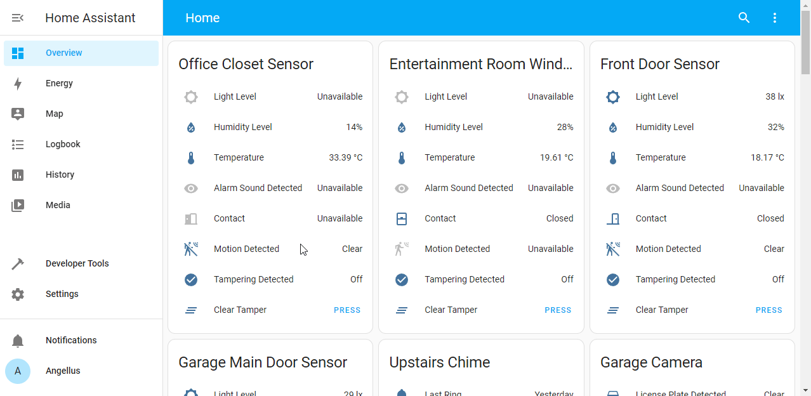
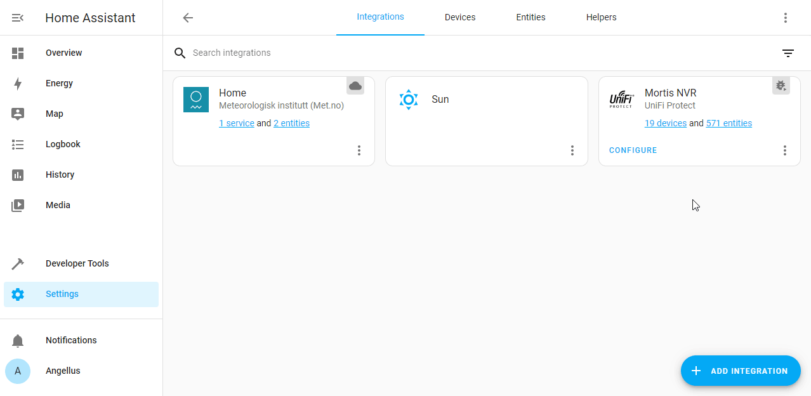
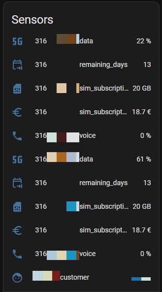

# Youfone for Home Assistant

A Home Assistant integration allowing to monitor your Youfone usage

> **Note:** To avoid IP blacklisting, the update interval is set to a minimum of 2 hours (configurable). On restart, Home Assistant loads data from local storage and refreshes after the configured interval.

### Features

- 📱 Mobile data usage sensors
- 🌍 World roaming bundle sensors
- 📞 Voice & SMS sensors
- 💰 Subscription price sensor
- 📅 Remaining days sensor
- 👤 User account information

---

<!-- [START BADGES] -->
<!-- Please keep comment here to allow auto update -->

<!-- [END BADGES] -->

## Table of Contents

- [Youfone for Home Assistant](#youfone-for-home-assistant)
  - [Features](#features)
  - [Table of Contents](#table-of-contents)
  - [Installation](#installation)
    - [Using the Home Assistant Marketplace (recommended)](#using-the-home-assistant-marketplace-recommended)
    - [Manual](#manual)
  - [Entities](#entities)
  - [Contributions are welcome](#contributions-are-welcome)
  - [Troubleshooting](#troubleshooting)
    - [Enable debug logging](#enable-debug-logging)
    - [Disable debug logging and download logs](#disable-debug-logging-and-download-logs)
  - [Screenshots](#screenshots)
  - [Code origin](#code-origin)

## Installation

### Using the [Home Assistant Marketplace](https://www.home-assistant.io/integrations/marketplace/) (recommended)

**Click on this button:**

**or follow these steps:**

1. Simply search for `Youfone` in the Home Assistant Marketplace and install it easily.
2. Restart Home Assistant
3. Add the 'Youfone' integration via HA Settings > 'Devices and Services' > 'Integrations'
4. Provide your Youfone username and password

### Manual

1. Copy the `custom_components/youfone` directory into your `config/custom_components/` folder
2. Restart Home Assistant
3. Go to **Settings → Devices & Services → Add Integration**
4. Search for `Youfone` and follow the configuration steps

## Entities

Each SIM card is represented as a separate device. The following sensors are created per SIM:

### SIM subscription sensors

| Entity | Description | Unit | Attributes |
| ------ | ----------- | ---- | ---------- |
| `sensor.youfone_customer` | Account holder name | – | Full customer info |
| `sensor.youfone_sim_subscription_<msisdn>` | Active subscription name | – | Full subscription info |
| `sensor.youfone_sim_subscription_price_<msisdn>` | Monthly subscription price | € | – |
| `sensor.youfone_data_<msisdn>` | Mobile data usage | % | Used, total, unlimited flag, msisdn |
| `sensor.youfone_voice_<msisdn>` | Voice & SMS usage | % | Used, total, unlimited flag, msisdn |
| `sensor.youfone_remaining_days_<msisdn>` | Days remaining in billing period | days | Period percentage |

### World roaming sensors

Shown only when a separately purchased world roaming bundle is active on the account (`SIM_ROAMING` card type).

| Entity | Description | Unit | Attributes |
| ------ | ----------- | ---- | ---------- |
| `sensor.youfone_sim_roaming_data_<msisdn>` | Roaming bundle data usage | % | Bundle name, destination (e.g. Marokko), used MB, total MB, due date, remaining days |

## Contributions are welcome

If you want to contribute to this please read the [Contribution guidelines](CONTRIBUTING.md)

## Troubleshooting

### Enable debug logging

To enable debug logging, go to Settings -> Devices & Services and then click the triple dots for the Youfone integration and click Enable Debug Logging.

### Disable debug logging and download logs

Once you enable debug logging, you ideally need to make the error happen. Run your automation, change up your device or whatever was giving you an error and then come back and disable Debug Logging. Disabling debug logging is the same as enabling, but now you will see Disable Debug Logging. After you disable debug logging, it will automatically prompt you to download your log file. Please provide this logfile.

## Screenshots

### Sensors

## Code origin

The code of this Home Assistant integration has been written by analysing the calls done by the Youfone website.

I have no link with Youfone
